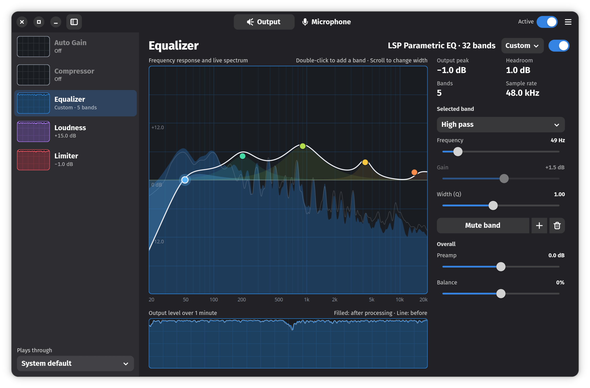

  

<h1 align="center">Equalizer</h1>

  A clean, simple equalizer for GNOME, written in Rust with GTK4 and libadwaita.

  

> **Early release:** this is version 0.0.7, so expect rough edges and changes between versions.

## Features

- **Graphical equalizer:** up to 32 bands, with a live spectrum behind an interactive graph
- **Full effect chains:** separate chains for your output and your microphone, including auto gain, compressor, limiter, loudness, and noise gate
- **System-wide:** a virtual device that all ordinary apps pass through
- **Presets:** save the equalizer and every effect together, with separate sets for listening and for your voice
- **Headphone correction:** import AutoEq and Equalizer APO files
- **Runs in the background:** sound processing can continue after you close the window, and it can start at login

Equalizer uses [PipeWire](https://pipewire.org) for routing and
[LSP Plugins](https://lsp-plug.in) for the sound processing.

## Install

Equalizer runs on PipeWire. The Flatpak brings the PipeWire parts it needs. The Arch
package and `install.sh` use your system's PipeWire, which must be 1.6.7 or newer:
older versions apply Equalizer's volume before the effects instead of after them.

To install the Flatpak,
[download the latest release](https://github.com/zoeruda/Equalizer/releases/latest)
and run:

    flatpak install --user ./Equalizer-*-x86_64.flatpak

The Flatpak is for x86_64 only. It gets the GNOME runtime from Flathub, but doesn't
update automatically, so check the releases page for new versions.

Every release is built from this repository by
[GitHub Actions](.github/workflows/release.yml), and its release notes show how to
verify the download.

Don't run the Flatpak and an `./install.sh` copy at the same time, as they would
create the same audio devices. While `install.sh`'s launcher exists, it also takes
the place of the Flatpak's in the app grid.

### Permissions

To create its virtual devices and route sound, the Flatpak connects directly to
PipeWire (`xdg-run/pipewire-0`) and identifies itself as an audio manager. This means
the sandbox doesn't limit what it can do with audio: it can see every audio device and
stream, record from them, including microphones, and change where sound goes.

The sandbox still limits the rest. The Flatpak has no network access, and apart from
its own settings, it can only read files you choose to import. It also has access to
your display and graphics hardware to draw its window.

A copy from `./install.sh` or the Arch package has no sandbox, so it runs with all the
access your user account has.

### Arch Linux

From a copy of this repository, build and install the package with:

    cd packaging/arch
    makepkg -si

This downloads the release that the `PKGBUILD` names, not the copy you're in. As with
the other versions, don't run it alongside another copy of Equalizer.

### Build from source

`install.sh` builds Equalizer and installs it into `~/.local`, without needing root.
It's made for Fedora, so what you need to set up first depends on your system:

| System | What you need first |
| --- | --- |
| Fedora, including immutable versions like Silverblue, Kinoite, and Bluefin | Rust and `toolbox`. The script builds in a container and sets up everything else |
| Other distributions (untested) | Rust and everything in the list below |
| Other immutable systems | Not supported, so use the Flatpak |

You need Rust 1.92 or newer, for example from [rustup](https://rustup.rs). Then run:

    ./install.sh

If you aren't using the toolbox, install these first:

- Development packages for GTK 4.14 or newer, libadwaita 1.5 or newer, and PipeWire
  1.6.7 or newer
- clang, gcc, and pkg-config
- LSP Plugins (`lsp-plugins-ladspa`), unless your system has `dnf`, which the script
  uses to download them

The script checks all of this before it starts. If something's missing, your system
isn't supported, or the build fails, it stops and explains why, and any earlier install
stays as it was.

### Build the Flatpak yourself

First, add Flathub if you don't have it, and install the build tools:

    flatpak remote-add --user --if-not-exists flathub https://dl.flathub.org/repo/flathub.flatpakrepo
    flatpak install --user flathub org.flatpak.Builder org.gnome.Platform//51 org.gnome.Sdk//51 org.freedesktop.Sdk.Extension.rust-stable//26.08 org.freedesktop.Sdk.Extension.llvm22//26.08

Then build and install the app:

    flatpak run org.flatpak.Builder --user --force-clean --disable-rofiles-fuse --repo=flatpak-repo flatpak-build io.github.zoeruda.Equalizer.yml
    flatpak build-bundle flatpak-repo Equalizer.flatpak io.github.zoeruda.Equalizer --runtime-repo=https://dl.flathub.org/repo/flathub.flatpakrepo
    flatpak install --user ./Equalizer.flatpak

The manifest currently supports x86_64 only, because its library paths are
hardcoded.

The GNOME runtime leaves out PipeWire's filter-chain module, so the manifest builds
it, along with LSP Plugins. Its PipeWire version must match the runtime's, so update
the two together.

## Use it

Equalizer adds a virtual device and makes it your default output, so all ordinary
apps pass through it. Turn **Active** off, or pick another output in system
settings, and sound goes straight to the device again.

While Active is on, Equalizer's volume is your speakers' or headphones' own volume:
the volume keys and the desktop's slider change the real device, and a change made on
the device shows on Equalizer's. So Active on and off play at the same loudness, and
the volume stays where you set it when you turn Active off or quit.

On the graph:

| Action | How |
| --- | --- |
| Change a band | Drag its point |
| Add a band | Double-click an empty spot |
| Change its width | Scroll over the point |
| Reset its gain | Double-click the point |
| Reset a slider | Double-click it |
| Type an exact value | Click the number beside a slider |
| Keyboard | Arrows move a point (Shift for fine steps), Tab and Shift+Tab cycle through the points, Delete removes one, + adds one, Escape leaves the graph |

The sidebar lists the effects in the order sound passes through them.

| Output | Microphone |
| --- | --- |
| Auto Gain | Noise Gate |
| Compressor | Auto Gain |
| Equalizer (up to 32 bands) | Equalizer (up to 32 bands) |
| Loudness | Compressor |
| Limiter | Limiter |

Presets save the equalizer and every effect. The Output and the Microphone each have
their own presets, since their effects differ: the Output's are for listening, and
the Microphone's are for your voice, such as Clear Voice, Noisy Room and Podcast.
You can also import AutoEq and Equalizer APO files, which is the usual format for
headphone correction.

Closing the window keeps the sound processing running by default. Open the app again to bring
the window back, and use **Quit** in the menu (Ctrl+Q) to stop it completely. You can also set it
to quit upon closing the window, or start at login, in the menu.

Settings live in `~/.config/equalizer/`, or in
`~/.var/app/io.github.zoeruda.Equalizer/config/equalizer/` for the Flatpak. Your
Output presets are in its `presets` folder, and your Microphone presets in
`presets/microphone`. Presets saved before 0.0.6 were shared, so they're copied to
both.

## How it works

| File | What it does |
| --- | --- |
| `src/engine.rs` | PipeWire thread: loads the plugin chain, creates the virtual device, handles device changes |
| `src/model.rs` | Settings and presets, the effect table, and how settings become plugin controls |
| `src/dsp.rs` | Filter response curves and the spectrum analyzer |
| `src/eq_graph.rs` | The interactive equalizer graph |
| `src/eq_widget.rs` | The widget the equalizer graph draws in: its still parts stay on the GPU as textures, and only the spectrum is redrawn each frame |
| `src/graphs.rs` | Shared drawing |
| `src/app.rs` | The window, pages, and the update loop |

The app has no real-time audio code of its own. The audio runs inside PipeWire's
filter-chain module, and the app sends it settings. New effects are mostly one new
entry in the `EFFECTS` table in `model.rs`, plus a place in `Direction::chain`.

## Tests

    cargo test
    DISPLAY=:0 python3 tests/measure.py target/release/equalizer
    DISPLAY=:0 python3 tests/mic.py target/release/equalizer
    DISPLAY=:0 python3 tests/memory.py target/release/equalizer
    DISPLAY=:0 python3 tests/ui.py target/release/equalizer

The second one runs the real app with tones going to a temporary silent device. It
compares what comes out with what the graph shows, and it needs a display and a
running PipeWire session.

The third does the same for the Microphone. It never opens your real microphone: it
plays its tones into a temporary fake one. It also clicks through the Microphone tab
using accessibility (AT-SPI), so it needs the Python bindings for it (`python3-gi`
with `Atspi` 2.0), and the window must stay uncovered. Quit Equalizer before running
either one, as only one copy can run.

The fourth looks for memory leaks. It repeats what a user does again and again
(playing music, hiding and showing the window, switching pages and tabs, turning
Active off and on, loading presets, adding bands, plugging in a device) and fails when
the app's memory keeps growing or its PipeWire objects aren't back to what they were.
It uses a silent device and a fake microphone as the others do, and the same
accessibility bindings. It takes about 25 minutes. Name one or more scenarios after
the binary to run only those: `playback`, `hide`, `pages`, `active`, `presets` or
`devices`. Its options:

- `--long` plays for an hour in all, instead of 4 minutes.
- `--quick` runs a tenth of each count, to try the test itself after changing it. Its
  runs are too short to tell whether memory really grows.
- `--limit MB` sets how much growth is allowed per 100 cycles, or per hour of
  playback (5 by default).
- `--wrap COMMAND` runs the app under another program, such as a heap profiler, to
  find where a failing scenario's memory goes:
  `tests/memory.py target/release/equalizer hide --wrap heaptrack`.

The fifth checks what the pointer does: double-clicks and drags on the graph,
double-clicks on the sliders, and typing in the numbers beside them. Accessibility can't press and release a
pointer, so it sends a real pointer and real keys through GNOME's remote-desktop
interface, and it only runs in a GNOME session. It leaves both chains off, so no sound
is touched. For about half a minute the pointer and the keyboard are the test's.

## Special recognition

Equalizer wouldn't look or work the way it does without two projects:

- **[Easy Effects](https://github.com/wwmm/easyeffects)** showed what a PipeWire
  effects app built on LSP Plugins can be. If you want a much larger set of effects
  and controls, it's the app to use.
- **[Mission Center](https://gitlab.com/mission-center-devs/mission-center)** inspired
  the look: its colorful, minimal, monitor-style graphs set the direction for
  Equalizer's interface.

Equalizer isn't affiliated with either project.

Thanks also to [LSP Plugins](https://lsp-plug.in) and
[PipeWire](https://pipewire.org), which do the actual audio work.

## License

Equalizer is licensed under the [GNU General Public License v3.0 or later](LICENSE).

The Flatpak also bundles [LSP Plugins](https://github.com/lsp-plugins/lsp-plugins)
(LGPL-3.0) and PipeWire's filter-chain modules (MIT), which keep their own licenses.
